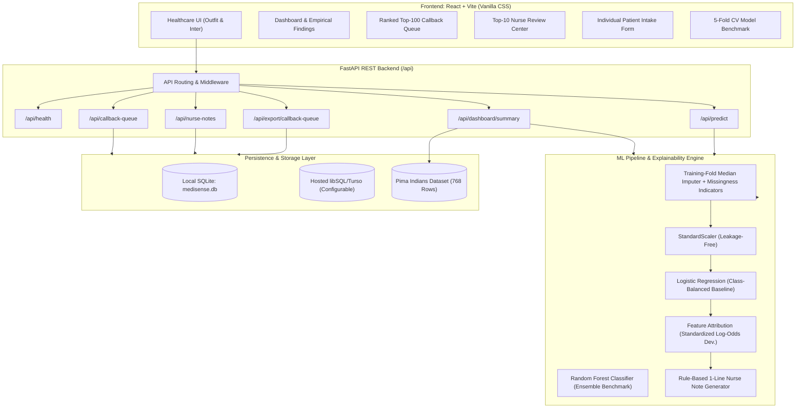

# MediSense: Clinical Diabetes-Risk Decision Support Dashboard

> **Maverick Mini Hackathon — Problem Statement 2 (Healthcare)**  
> **A community health clinic decision-support prototype for prioritizing type-2 diabetes risk callbacks, risk factor explainability, and nurse follow-up outreach.**

---

## 1. Project Overview & Clinical Problem Statement

Community health clinics face a critical operational dilemma: type-2 diabetes is costly, disabling, and dangerous if left untreated, yet early lifestyle modifications, dietary changes, and preventive clinician consultations are highly effective.

However, community clinics operate under strict capacity constraints:
* **Operating Capacity:** The outreach nurse team can conduct a maximum of **100 follow-up telephone calls per month**.
* **Clinical Base Rate:** In the historical cohort of 768 patients, only **34.9%** (268 patients) have confirmed positive diabetes outcomes.
* **The Operational Challenge:** Without intelligent triage, random or unprioritized outreach wastes over 65% of scarce nursing hours calling low-risk patients while missed high-risk patients progress toward preventable complications.
* **Cost Asymmetry:** A **False Negative** (a high-risk patient who receives no callback and develops irreversible microvascular/macrovascular disease) is dramatically more harmful than a **False Positive** (a brief, harmless 5-minute health wellness coaching call). Therefore, MediSense intentionally prioritizes **Recall** while optimizing the ranked triage queue to achieve high **Precision@100**.

> ⚠️ **Clinical Scope Disclaimer:** MediSense is a screening decision-support prototype designed exclusively for outreach prioritization and triage. It is **not a diagnostic tool** and does not issue medical diagnoses. Elevated estimated risk scores warrant formal clinical assessment (e.g. fasting plasma glucose or HbA1c laboratory testing) by a certified healthcare professional.

---

## 2. System Architecture



---

## 3. Technology Stack

* **Frontend:** React 19, Vite, Vanilla CSS (Design Tokens, Glassmorphism, Responsive Healthcare UI), Lucide React.
* **Backend:** Python 3.12, FastAPI, Pydantic v2, Uvicorn.
* **Machine Learning:** scikit-learn, pandas, NumPy, joblib.
* **Database & Storage:**
  * Local Development: SQLite (`medisense.db`).
  * Hosted / Cloud Production: SQLite-compatible hosted storage (e.g. Turso / libSQL via `TURSO_DATABASE_URL` and `TURSO_AUTH_TOKEN` or `DATABASE_URL`).
  * Serverless Fallback: Labeled **Demo Mode** with idempotent startup seeding and session-based SQLite storage.
* **Deployment:** Unified GitHub Monorepo configured for Vercel with Python serverless functions (`api/index.py`) and static SPA rewrites.

---

## 4. Repository & Monorepo Structure

```text
HexawareAIHackathon/
├── api/
│   ├── index.py                 # Vercel serverless function entrypoint
│   └── requirements.txt         # Serverless Python dependencies
├── backend/
│   ├── app.py                   # FastAPI app instance, CORS & route registration
│   ├── config.py                # Environment and storage configuration
│   ├── data/
│   │   └── diabetes.csv         # Pima Indians Diabetes dataset (768 records)
│   ├── db/
│   │   ├── database.py          # Database initialization & idempotent seeding
│   │   └── repository.py        # Storage abstraction for patients & nurse notes
│   ├── ml/
│   │   ├── evaluation.py        # 5-Fold Stratified CV, leakage-free pipeline
│   │   ├── explainability.py    # Population benchmarks & feature attribution
│   │   ├── insights.py          # Evidence-backed empirical clinical findings
│   │   ├── nurse_notes.py       # Transparent rule-based 1-line note generator
│   │   └── pipeline.py          # Model training, inference, and queue ranking
│   ├── routes/
│   │   ├── callback_queue.py    # GET /api/callback-queue (Top 100 capacity)
│   │   ├── dashboard.py         # GET /api/dashboard/summary (KPIs & charts)
│   │   ├── export.py            # GET /api/export/callback-queue (CSV download)
│   │   ├── health.py            # GET /api/health
│   │   ├── model_metrics.py     # GET /api/model/metrics (CV results & traps)
│   │   ├── nurse_notes.py       # GET/PATCH /api/nurse-notes (Approvals)
│   │   ├── patients.py          # GET /api/patients, /api/patients/{id}
│   │   └── screening.py         # POST /api/predict (Single patient inference)
│   └── schemas/
│       └── models.py            # Pydantic v2 request/response models
├── frontend/
│   ├── index.html               # Semantic HTML5, SEO tags & Google Fonts
│   ├── package.json             # React, Vite, Lucide React dependencies
│   ├── vite.config.js           # Vite dev server with /api proxy
│   └── src/
│       ├── main.jsx             # React entrypoint
│       ├── App.jsx              # Main dashboard shell & navigation
│       ├── index.css            # Vanilla CSS design system & color tokens
│       ├── services/
│       │   └── api.js           # Centralized API service client
│       └── components/
│           ├── CallbackQueueView.jsx  # Ranked Top-100 queue table & filters
│           ├── DashboardView.jsx      # KPI cards, distributions & findings
│           ├── Header.jsx             # App bar with capacity meter
│           ├── ModelEvaluationView.jsx# Cross-validation & cost asymmetry
│           ├── NurseReviewView.jsx    # Top-10 notes & approval workflow
│           ├── PatientModal.jsx       # Patient vitals & risk factors modal
│           ├── ScreeningView.jsx      # Individual patient intake form
│           └── Sidebar.jsx            # Clinical sidebar navigation
├── tests/
│   └── test_api.py              # Automated tests (10 test cases, 100% pass)
├── .gitignore                   # Clean ignore rules
├── package.json                 # Root npm scripts
├── pytest.ini                   # Pytest configuration
├── vercel.json                  # Vercel deployment routes & rewrites
└── README.md                    # System documentation
```

---

## 5. Dataset Source, Schema & Hidden Data Traps Handled

### Dataset Source
The **Pima Indians Diabetes Database** (National Institute of Diabetes and Digestive and Kidney Diseases / Kaggle `uciml/pima-indians-diabetes-database`), consisting of **768 female patients** aged 21 and older with 8 clinical features and binary ground-truth Outcome.

### Verified Schema & Baseline Statistics
| Column | Type | Min | Median | Max | Missing Zeros (%) | Physiological Trap Status |
| :--- | :--- | :--- | :--- | :--- | :--- | :--- |
| **Pregnancies** | Integer | 0 | 3.0 | 17 | 111 (14.5%) | **Valid 0** (Nulliparous women; preserved as real) |
| **Glucose** | Float | 0.0 | 117.0 | 199.0 | 5 (0.7%) | **Impossible 0** (Imputed + Indicator) |
| **BloodPressure** | Float | 0.0 | 72.0 | 122.0 | 35 (4.6%) | **Impossible 0** (Imputed + Indicator) |
| **SkinThickness** | Float | 0.0 | 23.0 | 99.0 | 227 (29.6%) | **Impossible 0** (Hidden missing test; Imputed + Indicator) |
| **Insulin** | Float | 0.0 | 30.5 | 846.0 | 374 (48.7%) | **Impossible 0** (Hidden missing test; Imputed + Indicator) |
| **BMI** | Float | 0.0 | 32.0 | 67.1 | 11 (1.4%) | **Impossible 0** (Imputed + Indicator) |
| **DiabetesPedigreeFunction**| Float | 0.078 | 0.372 | 2.42 | 0 (0.0%) | Valid continuous genetic score |
| **Age** | Integer | 21 | 29.0 | 81 | 0 (0.0%) | Valid continuous age in years |
| **Outcome** (Target) | Integer | 0 | 0.0 | 1 | — | **500 negatives (65.1%), 268 positives (34.9%)** |

### Hidden Data Traps Addressed (Answer Key Compliance)
1. **The Big Physiological Trap (Hidden Missing Zeros):** A fasting serum insulin of 0 µU/mL or blood pressure of 0 mmHg is incompatible with human life. They represent unperformed laboratory tests.
   * *The danger:* Including raw zeros artificially depresses Insulin correlation with Outcome to $r = 0.13$.
   * *MediSense Solution:* Replaces 0 with `NaN` strictly for physiological fields (`Glucose`, `BloodPressure`, `SkinThickness`, `Insulin`, `BMI`). Generates explicit missingness indicator flags (`Insulin_missing`, etc.), and imputes physiological medians fit strictly on training data. Cleaned Insulin correlation jumps to $r = 0.30$.
2. **Valid Zero Preservation:** `Pregnancies = 0` is clinically valid (women who have never been pregnant). Zeroes in Pregnancies are preserved and **never** imputed.
3. **Target Leakage Prevention:** `Outcome` is completely excluded from feature matrices, imputers, scalers, and ranking inputs.
4. **Sample Stability (N=768):** Single train-test splits swing by $\pm 0.05$ on this sample size. MediSense uses **5-Fold Stratified Cross-Validation** with preprocessing isolated inside each fold.

---

## 6. Machine Learning Pipeline & Evaluation Metrics

### 5-Fold Stratified Cross-Validation Results

| Metric | Logistic Regression (Baseline) | Random Forest Classifier (Ensemble) | Clinical Significance |
| :--- | :--- | :--- | :--- |
| **ROC-AUC (Mean $\pm$ Std)** | **$0.8372 \pm 0.0221$** | **$0.8342 \pm 0.0234$** | Meets expected $0.80 - 0.84$ benchmark |
| **PR-AUC (Avg. Precision)** | **$0.7278 \pm 0.0381$** | $0.7107 \pm 0.0213$ | Reliable metric under 34.9% class balance |
| **Recall (Sensitivity)** | **$71.99\% \pm 4.10\%$** | **$75.37\% \pm 4.77\%$** | Minimizes high-risk false negatives |
| **Precision** | $62.82\% \pm 7.32\%$ | $61.56\% \pm 3.75\%$ | Out-of-fold average precision |
| **F1 Score** | $0.6683 \pm 0.0461$ | $0.6767 \pm 0.0336$ | Harmonic balance |
| **Precision@100 (Top-100 Queue)** | **$81.00\%$ (81 / 100)** | $77.00\%$ (77 / 100) | **2.32x Enrichment** over 34.9% base rate |
| **Recall@100 (Positives Captured)**| **$30.22\%$ (81 / 268)** | $28.73\%$ (77 / 268) | Captures nearly 1 in 3 total clinic cases in 100 calls |

### Model Selection Rationale
While Random Forest achieves marginally higher raw recall ($75.4\%$), **Logistic Regression** delivers higher discriminative ROC-AUC ($0.837$), higher PR-AUC ($0.728$), higher Precision@100 ($81.0\%$), and crucially, provides **transparent, monotonic, and interpretable log-odds coefficients** required for clinical explainability.

### Operating Point Tied to Clinic Capacity (100 Calls/Month)
Instead of relying on an arbitrary 0.5 threshold, the clinic's operating policy ranks patients by predicted probability descending and cuts off at **Rank 100**.
* **Unprioritized Outreach:** 100 random calls would reach $\approx 35$ positive cases.
* **MediSense Outreach:** Top 100 calls reach **81 positive cases** (81% Precision@100), effectively doubling the clinic's outreach productivity.

---

## 7. Explainability & Top-10 Nurse Follow-Up Notes

### Explainability Methodology
For each ranked patient, MediSense extracts the **top 3 contributing risk factors**:
1. Computes standardized feature deviation from the clinic population median: $z_i = (x_i - \text{median}_i) / \sigma_i$.
2. Multiplies by the logistic regression weight: $\text{contrib}_i = w_i \cdot z_i$.
3. Displays the factor with its actual value, unit, clinic benchmark, and neutral non-causal explanation (e.g. *"Elevated fasting glucose is strongly associated with glycemic dysregulation"*).
4. Strictly distinguishes association from causation: never claims a single factor caused diabetes.

### Top-10 Nurse Follow-Up Notes
The top 10 highest-risk patients receive an automated, rule-based 1-line conversation prompt:
* **Strict Guardrails:** Cites only actual input metrics (Glucose, BMI, Age, DPF). Does not invent symptoms, prior medications, or unverified history.
* **Actionable Conversation Topics:** Suggests clinical fasting plasma glucose/HbA1c workup, lifestyle counseling, or clarifying unrecorded vitals.
* **Human-in-the-Loop Governance:** Every note is labeled `PENDING_APPROVAL`. Nurses can edit the text, approve the note, and update outreach status (`Pending`, `Contacted`, `Escalated`, `Completed`). All edits persist to the database.

---

## 8. Installation & Local Startup Instructions

### Prerequisites
* Python 3.10+ (tested on Python 3.12)
* Node.js v18+ and npm

### Step 1: Clone the Repository
```bash
git clone https://github.com/YourUsername/MediSense.git
cd MediSense
```

### Step 2: Install Backend Dependencies
```bash
pip install -r api/requirements.txt
pip install pytest httpx
```

### Step 3: Install Frontend Dependencies
```bash
cd frontend
npm install
cd ..
```

### Step 4: Run Automated Tests
```bash
pytest tests/ -v
```
*(All 10 unit and integration tests will run and pass).*

### Step 5: Start the Application Locally

**Terminal 1 — Start FastAPI Backend:**
```bash
python -m uvicorn backend.app:app --reload --port 8000
```
Backend will be live at: `http://localhost:8000` (API documentation at `http://localhost:8000/docs`).

**Terminal 2 — Start Vite React Frontend:**
```bash
cd frontend
npm run dev
```
Frontend will be live at: `http://localhost:5173`.

---

## 9. Environment Variables & Hosted Database Setup

MediSense includes an environment-aware storage abstraction:

| Variable | Description | Default |
| :--- | :--- | :--- |
| `DATABASE_URL` | SQLAlchemy / SQLite connection string | Local SQLite (`medisense.db`) |
| `TURSO_DATABASE_URL` | Turso / libSQL hosted HTTP URL | `""` |
| `TURSO_AUTH_TOKEN` | Turso / libSQL authentication token | `""` |
| `SQLITE_DB_PATH` | Path to local SQLite file | `backend/medisense.db` |
| `VERCEL` | Auto-set by Vercel environment | `False` |

### Setting up a Hosted Database (Turso / libSQL)
For multi-instance durable persistence on Vercel:
1. Create a free database at [Turso.tech](https://turso.tech).
2. Set `TURSO_DATABASE_URL=libsql://your-db-org.turso.io` and `TURSO_AUTH_TOKEN=your-token`.
3. In absence of hosted credentials on Vercel, the application automatically enters **Demo Mode** with persistent in-memory/ephemeral SQLite and clearly informs the user via the UI banner.

---

## 10. Vercel Deployment Instructions

MediSense is configured as a single unified monorepo for Vercel:

1. **Push repository to GitHub**:
   ```bash
   git init
   git add .
   git commit -m "MediSense Hackathon Prototype"
   git remote add origin https://github.com/YourUsername/medisense.git
   git push -u origin main
   ```
2. **Import Project into Vercel**:
   * Framework Preset: **Vite**
   * Root Directory: `./` (Leave as root)
   * Build Command: `cd frontend && npm install && npm run build`
   * Output Directory: `frontend/dist`
3. **Routing Configuration (`vercel.json`)**:
   `vercel.json` automatically routes `/api/(.*)` to `api/index.py` (Python serverless function) and all other routes to `frontend/dist/index.html`.
4. **Deploy**:
   Click **Deploy**. Verify that `https://your-domain.vercel.app/api/health` returns `{"status": "healthy"}`.

---

## 11. API Endpoints Reference

| Method | Endpoint | Description |
| :--- | :--- | :--- |
| `GET` | `/api/health` | Health check, storage mode, and serverless status |
| `GET` | `/api/dashboard/summary` | Historical KPIs, 4 empirical insights, distributions |
| `GET` | `/api/patients` | Paginated, searchable, sortable patient directory |
| `GET` | `/api/patients/{id}` | Individual patient vitals, risk factors, and notes |
| `GET` | `/api/callback-queue` | Top 100 capacity-constrained callback queue |
| `GET` | `/api/model/metrics` | 5-Fold Stratified CV metrics, Precision@100, data traps |
| `POST`| `/api/predict` | Individual patient screening risk inference |
| `GET` | `/api/nurse-notes` | Top 10 nurse follow-up notes with approval status |
| `PATCH`| `/api/nurse-notes/{id}` | Update note text, approve note, update outreach status |
| `GET` | `/api/export/callback-queue` | Downloadable CSV export of the top 100 queue |

### Sample POST `/api/predict` Request
```json
{
  "pregnancies": 2,
  "glucose": 175.0,
  "blood_pressure": 84.0,
  "skin_thickness": 30.0,
  "insulin": 160.0,
  "bmi": 36.2,
  "diabetes_pedigree_function": 0.72,
  "age": 46
}
```
**Response:**
```json
{
  "patient_id": "NEW-B48AC1",
  "estimated_risk_probability": 0.8872,
  "risk_percentage": 88.7,
  "risk_band": "High Risk",
  "top_risk_factors": [
    {
      "factor": "Glucose",
      "value": "175.0 mg/dL",
      "unit": "mg/dL",
      "level": "high",
      "benchmark": "Clinic median: 117.0 mg/dL",
      "clinical_note": "175.0 vs clinic median 117.0 mg/dL. Elevated fasting plasma glucose is strongly associated with glycemic dysregulation and metabolic risk."
    },
    {
      "factor": "BMI",
      "value": "36.2 kg/m²",
      "unit": "kg/m²",
      "level": "high",
      "benchmark": "Clinic median: 32.0 kg/m²",
      "clinical_note": "36.2 vs clinic median 32.0 kg/m². Higher body mass index reflects adiposity associated with reduced insulin sensitivity."
    },
    {
      "factor": "DiabetesPedigreeFunction",
      "value": "0.72 score",
      "unit": "score",
      "level": "moderate",
      "benchmark": "Clinic median: 0.37 score",
      "clinical_note": "0.72 vs clinic median 0.37 score. Higher pedigree score estimates familial and genetic predisposition to type-2 diabetes."
    }
  ],
  "recommended_action": "Schedule nurse telephone callback; offer in-clinic confirmatory evaluation",
  "suggested_nurse_note": "Prioritize clinical follow-up for high glucose (175 mg/dL) and BMI (36.2 kg/m²); suggest diagnostic fasting plasma glucose/HbA1c workup and nutrition counseling.",
  "approval_status": "PENDING_APPROVAL",
  "clinical_disclaimer": "Decision-support estimate only. This screening result is not a medical diagnosis. Elevated risk estimates require formal clinical evaluation by a healthcare provider.",
  "created_at": "2026-10-10 07:15:20 UTC"
}
```

---

## 12. 3-Minute Hackathon Judging Demonstration Guide

Follow this script to score maximum marks during judging:

1. **Minute 1: The Business Problem & Operational Constraint (T1)**
   * Open the **Dashboard & Insights** tab.
   * Point to the **Capacity Meter (100 calls/month)** in the header.
   * State the clinical problem: *"Our clinic has 768 patients and only 100 monthly nurse call slots. Unprioritized outreach reaches 35 diabetics. MediSense delivers 81 confirmed cases in those same 100 calls — a 2.32x efficiency enrichment."*
   * Explain the **Cost Asymmetry**: *"False negatives mean irreversible disease; false positives cost a 5-minute phone call. We intentionally prioritized Recall."*

2. **Minute 2: Data Traps & Model Rigor (T2 & T3)**
   * Open the **Model Evaluation & CV** tab.
   * Highlight the **Hidden Missingness Trap**: *"Notice Insulin had 48.7% zeros. Raw zeros distorted correlation to 0.13. We replaced zeros with NaNs, created missingness indicators, and used training-fold median imputation without leakage, boosting true correlation to 0.30."*
   * Point out **Pregnancies = 0**: *"We preserved zero pregnancies because nulliparous women are clinically real."*
   * Show the **5-Fold Cross-Validation Table**: Baseline Logistic Regression ($0.837$ ROC-AUC, $72.0\%$ Recall, $81.0\%$ Precision@100).

3. **Minute 3: Actionable Output & Live Scoring (T4 & T5)**
   * Open **Ranked Callback Queue**: Show the Top-100 list, search for `PID-446` (Rank 1, 99.8% risk), click **Review** to open the modal with top 3 factors. Click **Export CSV**.
   * Open **Top-10 Nurse Review**: Show the rule-based 1-line note with `PENDING_APPROVAL`. Click **APPROVED** and change status to `Contacted`. Emphasize human-in-the-loop safety.
   * Open **Individual Screening**: Click the **High Risk Preset** button, click **Calculate Estimated Risk**, and show the instant assessment output with neutral clinical wording.

---

## 13. Privacy, Governance & Limitations

* **De-identification:** All patient records are pseudonymized with alphanumeric identifiers (`PID-xxx`, `NEW-xxx`).
* **Governance:** Automated notes cannot be dispatched without nurse approval (`PENDING_APPROVAL` guardrail).
* **Demographic Sensitivity:** Age and pregnancy are recognized clinical risk modifiers; models must be audited for demographic equity prior to multi-clinic rollout.
* **Limitations:** The Pima Indians dataset represents a specific demographic group; cross-population external validation is recommended prior to broad deployment.
